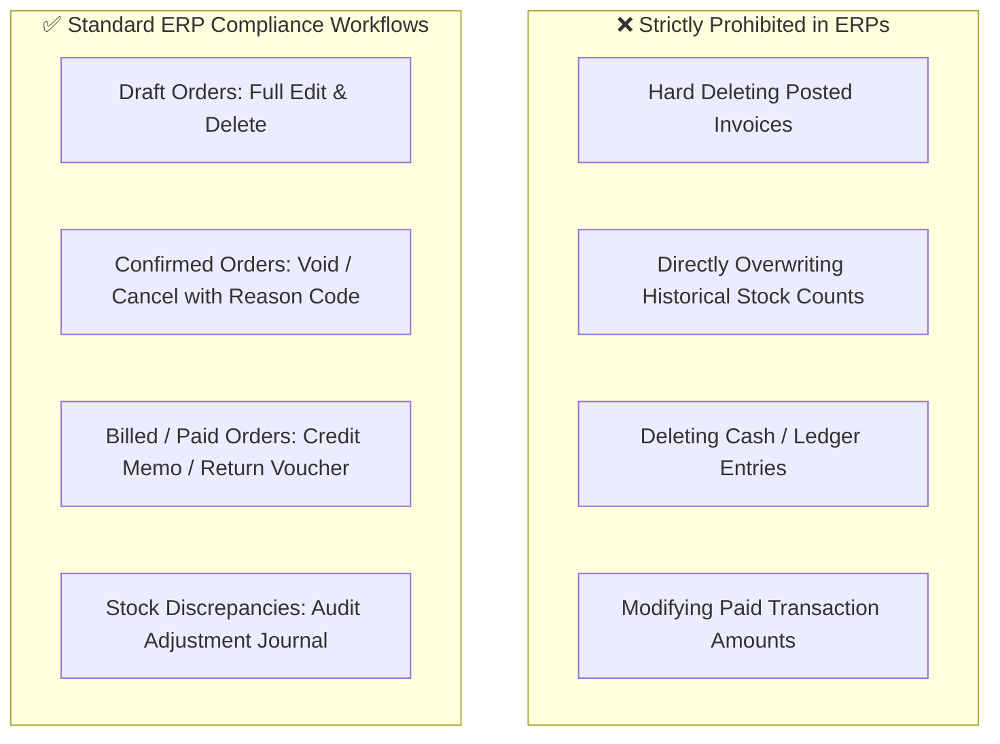

# Enterprise ERP Audit & Admin CRUD Governance Analysis
**System:** JAPA Core ERP — Multi-Store Operations  
**Date:** November 2026  
**Standards Evaluated:** GAAP, IFRS, SOC 1 / SOX Internal Controls, SAP ERP, NetSuite, Odoo

---

## Executive Summary

This report addresses two critical aspects of the JAPA Core ERP system:
1. **Root-Cause Diagnostic:** Why Admin actions (Add, Edit, Delete) on stocks, sales, and related entities are currently failing or unavailable in the codebase.
2. **Global ERP Best Practices & Governance Matrix:** A comprehensive research-backed analysis detailing exactly what an Admin **should and should not be permitted** to Add, Edit, Delete, or Void across Sales, Inventory, Cash, and Financials.

---

## Part 1: Technical Root-Cause Inspection (Why It Fails in Code Today)

### 1.1 Stocks & Inventory: The Multi-Branch Desynchronization Bug

| Action | Current Status | Code Location | Root Cause in Code |
| :--- | :--- | :--- | :--- |
| **Adjust Stock** | **Silently Ignored** in Branch View | [stock-adjustment-modal.tsx](file:///c:/Users/gain%20carlo/jbms-erp-system/components/inventory/stock-adjustment-modal.tsx#L63-L65) | The modal executes `UPDATE products_and_inventory SET stock_quantity = ...`. However, `inventory-view.tsx` loads stock from the separate `inventory_stock` table when viewing Dagupan or Manila (`activeBranchId !== 'all'`). Because `inventory_stock` is never updated, the adjustment is instantly overridden by the old branch balance. |
| **Add Product** | **Orphaned from Branches** | [product-form-modal.tsx](file:///c:/Users/gain%20carlo/jbms-erp-system/components/inventory/product-form-modal.tsx#L146) | Inserts into `products_and_inventory` catalog, but fails to seed corresponding rows in `inventory_stock` for `dagupan_main` and `manila_branch`. |
| **Delete Product** | **Blocked on Foreign Keys** | [inventory-view.tsx](file:///c:/Users/gain%20carlo/jbms-erp-system/components/inventory/inventory-view.tsx#L196) | If the product is referenced in `stock_transfer_items`, `job_orders`, or past transaction line items, PostgreSQL throws a foreign key constraint violation. |

### 1.2 Sales & Quotations: Missing Controls & Omitted RLS

| Action | Current Status | Code Location | Root Cause in Code |
| :--- | :--- | :--- | :--- |
| **Edit Sales Order** | **No UI Exists** | [sales-view.tsx](file:///c:/Users/gain%20carlo/jbms-erp-system/components/sales/sales-view.tsx) | The UI only renders a single `<Eye>` ("View") button. `OrderDetailModal.tsx` is completely read-only with only a "Print" and "Close" button. |
| **Delete Sales Order** | **Database & UI Blocked** | [03_sales_orders_policies.sql](file:///c:/Users/gain%20carlo/jbms-erp-system/supabase/migrations/03_sales_orders_policies.sql) | 1. No delete button in UI. 2. Supabase RLS has `allow anon read dev`, `allow anon insert dev`, `allow anon update dev`, but **zero DELETE policy**. |
| **Cancel / Void Order** | **Partially Supported in Schema, Missing in UI** | [03_sales_orders_policies.sql](file:///c:/Users/gain%20carlo/jbms-erp-system/supabase/migrations/03_sales_orders_policies.sql) | The database check constraint allows `'Cancelled'`, but there is no "Cancel Order" action button in the detail view. |

---

## Part 2: Industry Research & ERP Governance Principles

Under **GAAP (Generally Accepted Accounting Principles)**, **IFRS**, and standard internal control frameworks (COSO / SOC 1 / SOX), business transactions must maintain an **immutable audit trail**.

### The Three Golden Rules of ERP Data Integrity

1. **Never "Hard Delete" a Completed Transaction:**
   - In accounting and warehouse management, a recorded sale or stock movement is a legal and financial record. If an order with invoice number `INV-20261106-6767` is deleted, a gap is left in the sequential numbering. Tax authorities (such as BIR in the Philippines) penalize missing sequential numbers, and auditors flag it as fraud risk.
2. **Use "Contra-Entries" Instead of Overwrites:**
   - If stock was miscounted or damaged, you do not rewrite history. You post an **Inventory Adjustment Journal** with a reason code (*Shrinkage, Damage, Cycle Count Variance*). This documents both what happened and who approved it.
3. **Segregation of Lifecycle Stages (Draft vs. Posted):**
   - **Draft / Quotation:** Uncommitted. Can be freely edited or discarded.
   - **Approved / In Production:** Committed. Quantity changes require an amendment; cancellations must release reserved materials.
   - **Paid / Delivered:** Locked. Changes can only occur through **Credit Memos**, **Return Merchandise Authorizations (RMA)**, or **Debit Vouchers**.

---

## Part 3: What Admin SHOULD vs SHOULD NOT Be Allowed to Do

The matrix below outlines the industry-standard permissions for the **Admin** role in JAPA Core ERP:

| Module | Entity | ✅ Allowed for Admin | ⚠️ Controlled (Requires Reason / Reversal) | ❌ Strictly Forbidden (Never Allowed) |
| :--- | :--- | :--- | :--- | :--- |
| **Sales** | **Quotations / Drafts** | • Create new quotation • Edit customer, items, prices • Discard / Delete draft | — | — |
| **Sales** | **Confirmed Orders (Unpaid)** | • Update delivery address • Assign to production queue | • **Cancel / Void Order** (Must log reason in Audit Log and release reserved inventory) | • Direct modification of total amount without item line reconciliation |
| **Sales** | **Paid / Completed Orders** | • View details & print receipt • Export invoice PDF | • **Issue Refund / Return** (Generates a Cash Disbursement Voucher CDV + Stock Restock entry) | • **Hard Delete** (Permanently destroying the transaction record) |
| **Inventory** | **Catalog Items (Master Data)** | • Add new product & SKU • Edit name, category, prices, reorder point | • **Archive / Deactivate Product** (Hides from POS/Sales dropdowns while preserving history) | • **Hard Delete** if product has sales history or transfer records |
| **Inventory** | **Stock Quantities** | • View stock across all branches • Approve inter-branch STO transfers | • **Manual Stock Adjustment** (Must specify: Branch, Type [Restock/Loss/Audit], and reason) | • Silently overwriting stock without logging an audit trail or branch tag |
| **Cash** | **Cash Transactions (CRV/CDV)** | • Record manual cash inflow/outflow • Execute account transfers | • **Void Cash Voucher** (Creates reversing contra-entry; original entry is marked `voided`) | • **Hard Delete** or editing an already posted cash transaction |
| **Cash** | **Drawer Reconciliation** | • Perform end-of-shift balancing • Authorize variance write-offs | • Manager override for cash drawer discrepancies | • Deleting past shift reconciliation logs |
| **Financials** | **Expenses & P&L** | • Record operational expenses • View P&L, margins, profit | • Edit pending expense before payment | • Deleting paid expenses without generating an audit reversal |

---

## Part 4: Recommended Action Plan for JAPA Core ERP

### Step 1: Fix Stock Adjustment Multi-Branch Sync
Modify [`stock-adjustment-modal.tsx`](file:///c:/Users/gain%20carlo/jbms-erp-system/components/inventory/stock-adjustment-modal.tsx) and [`product-form-modal.tsx`](file:///c:/Users/gain%20carlo/jbms-erp-system/components/inventory/product-form-modal.tsx):
1. When stock is adjusted or added, update **both** `products_and_inventory` and `inventory_stock` for the target branch (`activeBranchId`).
2. If `activeBranchId === 'all'`, update both `dagupan_main` and `manila_branch`.

### Step 2: Implement "Cancel / Void Order" on Sales
Instead of a destructive "Delete" button on sales orders:
1. In `OrderDetailModal.tsx`, add a **"Cancel / Void Order"** button for Admin.
2. Clicking it prompts for a cancellation reason, updates `order_status` to `'Cancelled'`, releases any linked job orders, and writes an entry to `public.audit_logs`.

### Step 3: Implement Soft Delete / Archive for Inventory
1. Add `is_active BOOLEAN DEFAULT TRUE` to `products_and_inventory`.
2. When an Admin clicks "Delete Product", if the product has transaction history, the system archives it (`is_active = false`) so it no longer appears in POS or catalog, while preserving full reporting integrity.

---
*Prepared by JAPA Core Systems Engineering & Governance.*

