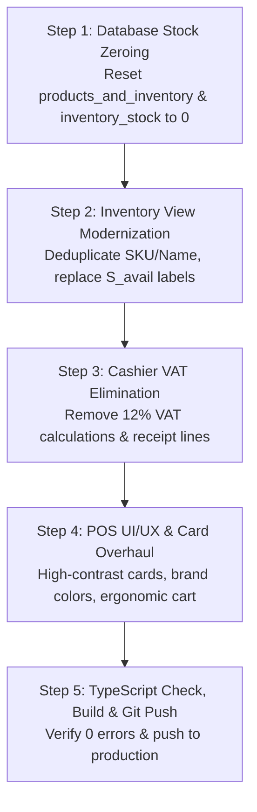

# JAPA Core ERP — Inventory & POS Modernization Blueprint
**Document Version:** 2.0  
**Target Modules:** Multi-Store Inventory (`/inventory`) & Cashier POS Terminal (`/pos`)  
**Status:** Architecture & Research Plan (Awaiting User Sign-Off Before Code Changes)

---

## 1. Executive Summary & Problem Diagnosis

Based on real-world testing and user feedback from the Dagupan and Manila operations, four critical friction points have been identified in the inventory and cashier systems:

```
┌────────────────────────────────────────────────────────────────────────────────────────┐
│                                   CORE USER CHALLENGES                                 │
├───────────────────────────────┬────────────────────────────────────────────────────────┤
│ 1. Text Redundancy / Doubling │ "1.1 CAPS-BUCKET HAT-ACID WASH..." appears twice       │
│                               │ identically in both SKU and Product Name columns/cards.│
├───────────────────────────────┼────────────────────────────────────────────────────────┤
│ 2. Erroneous Stock Counts     │ Initial CSV import carried 3,613 available units and    │
│                               │ 115,314 audit units. User wants all stock reset to 0.  │
├───────────────────────────────┼────────────────────────────────────────────────────────┤
│ 3. Cryptic Math Terminology   │ Labels like S_avail, S_res, S_audit look like math code │
│                               │ instead of standard retail business terms.             │
├───────────────────────────────┼────────────────────────────────────────────────────────┤
│ 4. POS UI, Colors & VAT       │ POS looks washed out/faint; cards show "Price TBD";    │
│                               │ 12% VAT is displayed but must be completely removed.   │
└───────────────────────────────┴────────────────────────────────────────────────────────┘
```

---

## 2. Problem 1: Redundant SKU & Product Name Doubling

### 2.1 Root Cause Analysis
An automated audit of all 2,556 products in `products_and_inventory` revealed:
- **576 consumable items** (caps, tapes, inks, vinyl, transfer papers) have **100% identical strings** in both `sku` and `item_name`.
  - Example: SKU = `1.1 CAPS-BUCKET HAT-ACID WASH-ASST. C`, Name = `1.1 CAPS-BUCKET HAT-ACID WASH-ASST. C`.
- **1,980 apparel items** (Smilee, Gildan, 3K, Winner, Fruit of the Loom) have nearly identical strings, differing only by delimiters (`-` vs `/`).
  - Example: SKU = `76000 GILDAN PREMIUM-BLACK-LG-ADULT RN`, Name = `76000 GILDAN PREMIUM/BLACK/LG/ADULT RN`.

In the current UI:
- **Inventory Table:** Column 1 displays the SKU tag, and Column 2 displays the Product Name right next to it, making users read the exact same 35-character string twice in every single row.
- **POS Catalog Cards:** The card header displays the Category, the card title displays the Name, and the card subtitle repeats the identical SKU, creating visual clutter and reducing readability on POS screens.

### 2.2 ERP Industry Benchmarks (Shopify POS, Lightspeed, Square for Retail)
Modern retail & wholesale systems solve this via **Smart Product Cell Consolidation**:
1. **Never repeat identical text:** If `SKU` equals `Product Name` (or differs only by punctuation), render a single clean **Title** and display the SKU in a small, distinct monospace badge.
2. **Humanized Title Formatting:**
   - Remove internal bookkeeping prefixes where appropriate (e.g. `1.1 CAPS-` becomes `Bucket Hat - Acid Wash (Asst. Colors)`).
   - Display the primary product name in prominent typography, with Brand and Category badges clearly separated.
3. **Inventory Table Layout:**
   - Instead of two repetitive wide columns (`SKU & Barcode` AND `Product Name`), combine them into a single ergonomic column: **Item Details**:
     - Line 1: **Clean Product Title** (Bold, readable text)
     - Line 2: `SKU: 1.1 CAPS-BUCKET...` (Small monospace pill) • `UPC: —`
     - Line 3: Category tag inline (e.g. `Digital Consumable`)
   - This frees up **220px of horizontal table space**, eliminates horizontal scrolling, and makes the table look clean and executive.

---

## 3. Problem 2: Complete Stock Zeroing (Clean Slate)

### 3.1 Business Context
When the master CSV (`Inventory Records JAPA GLOBAL DAGUPAN.csv`) was imported, historical quantities and negative book inventory balances from legacy spreadsheets were imported into the database:
- `stock_quantity`: Totaled 3,613 units across various rows.
- `quarantine_stock`: Totaled 115,314 units (from historical spreadsheet discrepancies).
- `inventory_stock`: Contains 5,112 rows (2 branches × 2,556 items) with lingering numbers.

The owner's decision:
> *"Remove all of the available stocks that is being counted, let me just modify those later."*

The business needs a **pristine clean slate of 0 stock** across all 2,556 catalog items in all branches so the warehouse team can conduct an accurate physical stock count and enter real counts via the Adjust Stock modal or Batch Stock In.

### 3.2 SQL Migration Strategy
Execute migration `13_reset_inventory_stock_to_zero.sql` on Supabase:
```sql
-- Reset catalog level totals to 0
UPDATE products_and_inventory
SET 
  stock_quantity = 0,
  reserved_stock = 0,
  in_transit_stock = 0,
  quarantine_stock = 0;

-- Reset branch-level inventory records to 0
UPDATE inventory_stock
SET 
  quantity_on_hand = 0,
  reserved_quantity = 0,
  in_transit_quantity = 0,
  quarantine_quantity = 0;

-- Ensure transfer ledgers are clean of ghost balances
UPDATE stock_transfers
SET status = 'cancelled'
WHERE status = 'pending' OR status = 'in_transit';
```

---

## 4. Problem 3: Clarifying Stock Statuses & Removing Math Formulas

### 4.1 Plain-English Terminology Replacement Matrix
The blueprint originally used mathematical modeling variables ($S_{avail}$, $S_{res}$, $S_{trans}$, $S_{audit}$). These are developer/academic formulas that confuse store clerks and business owners.

| Current Technical Label | Confusing Code | New Plain Business Label | Plain Business Definition |
|:---|:---:|:---|:---|
| `Available Stock (S_avail)` | `$S_{avail}$` | **On-Shelf Stock** | Physical stock in store ready for walk-in checkout. |
| `Reserved Stock (S_res)` | `$S_{res}$` | **Reserved / Layaway** | Items allocated for print jobs, pending COD, or downpayments. |
| `In-Transit Stock (S_trans)` | `$S_{trans}$` | **Incoming Transfers** | Stock currently on delivery vehicles between Dagupan & Manila. |
| `Quarantine / Audit (S_audit)` | `$S_{audit}$` | **Damaged / Review** | Defective shirts, misprints, or items set aside for manager audit. |

### 4.2 Redesigned Metric Cards (`InventorySummaryCards`)
Instead of displaying raw math counters, present the 4 standard executive KPI cards:

```
┌────────────────────────┐ ┌────────────────────────┐ ┌────────────────────────┐ ┌────────────────────────┐
│  TOTAL CATALOG ITEMS   │ │   TOTAL UNITS ON HAND  │ │   LOW STOCK ALERTS     │ │  OUT OF STOCK ITEMS    │
│         2,556          │ │             0          │ │            0           │ │         2,556          │
│ 6 Departments·14 Brands│ │ Awaiting initial count │ │ Items below threshold  │ │ Ready for stock-in     │
└────────────────────────┘ └────────────────────────┘ └────────────────────────┘ └────────────────────────┘
```

### 4.3 Redesigned Table Columns
Replace the 3 separate columns (`AVAILABLE (S_AVAIL)`, `RESERVED (S_RES)`, `AUDIT (S_AUDIT)`) with:
1. **Stock on Shelf:** A bold count (e.g. `0`) with a clear status badge:
   - `In Stock` (Green pill when > 0)
   - `Low Stock` (Amber pill when 1 to 10)
   - `Out of Stock` (Zinc pill when 0)
2. **Allocations:** Clean contextual badges only shown if applicable:
   - `📦 5 Reserved`
   - `🚚 20 In-Transit`
   - `⚠️ 2 Damaged`
   - Shows `—` if clean (reducing table clutter by 70%).

---

## 5. Problem 4: Cashier POS Modernization & 100% VAT Removal

### 5.1 Complete VAT Elimination
- **User Directive:** *"remove the VAT in the cashier we do not need that"*
- Printing, garment customization, and wholesale apparel operations often operate on gross non-VAT pricing. Cashiers should not see or charge 12% BIR VAT calculations.
- **Changes in `pos-view.tsx` & `pos-checkout-panel.tsx`:**
  - Remove `VAT_RATE = 0.12`.
  - Remove `vatAmount` from totals calculation.
  - Calculation formula becomes clean and direct:
    $$\text{Grand Total} = \text{Subtotal} - \text{Discount}$$
  - Remove `12% VAT Included (₱0.00)` line item from Order Summary.
  - Remove VAT lines from receipt modals (`pos-receipt-modal.tsx`, `pos-transaction-modal.tsx`).
  - Senior Citizen / PWD 20% discount applies directly to Subtotal without VAT exclusion formulas.

### 5.2 POS UI, Colors & View Overhaul

#### A. Header & Environment Styling
- **Current Issue:** The dark purple gradient (`bg-gradient-to-r from-indigo-700 to-indigo-900`) feels harsh, heavy, and disjointed from the rest of the light ERP interface.
- **New Design:** A clean, professional **High-Contrast Slate Bar**:
  - Soft neutral slate background (`bg-slate-900` or clean white with indigo accent borders).
  - High-visibility Barcode Scanner dock: `[ 📷 SCAN OR TYPE SKU / BARCODE ]` with glowing cyan/indigo border on focus.
  - Branch toggle (`Dagupan Main` vs `Manila Hub`) with active green LED indicator.
  - Cash Drawer shortcut button (`₱ Cash & Safe Drop`).

#### B. Product Catalog Cards
- **Current Issue:** All cards look washed out, gray, and text is small and repetitive. Prices show faint `Price TBD` and `⚠️ Depleted`.
- **New Card Architecture:**
  - **Surface:** Pure white card with crisp border (`border-slate-200`) and soft card shadow (`shadow-xs hover:shadow-md`).
  - **Category / Brand Tag:** Color-coded badges:
    - Smilee: Blue-50 / Blue-700
    - Gildan: Emerald-50 / Emerald-700
    - 3K: Violet-50 / Violet-700
    - Digital: Amber-50 / Amber-700
    - Silkscreen: Rose-50 / Rose-700
  - **Prominent Size Badge:** Large top-right pill (e.g. `[ XL ]` or `[ 2XL ]`) with high-contrast text.
  - **Clean Product Title:** Deduplicated product name, high-contrast black text (`text-slate-900 font-semibold line-clamp-2`).
  - **SKU Tag:** Subtle monospace sub-tag (`text-[10px] text-slate-400 font-mono`).
  - **Price Display:**
    - If price > 0: Bold vibrant green or indigo (`₱220.00`).
    - If price == 0: Clean `₱0.00` with clickable "Set Price" prompt.
  - **Stock Status Badge:**
    - Stock = 0: `Out of Stock` (grayed pill, but still clickable for pre-orders/job orders if allowed).
    - Stock > 0: `● In Stock (24)` in rich emerald green.
  - **Cart Count Indicator:** Vibrant indigo floating circle `[ 2 ]` when the product is in the cart.

#### C. Active Cart & Checkout Panel Ergonomics
- **Empty State:** Instead of a giant blank white void, show a friendly illustrated guide:
  - *"🛒 Scan a barcode, type a SKU, or tap products to begin a transaction"*
- **Item List:**
  - Large (+) and (-) stepper buttons for fast touch adjustment.
  - Unit price override button for wholesale discounts.
  - Quick remove button.
- **Payment Method Dock:**
  - 4 large, tactile touch cards:
    - 💵 **Cash**
    - 📱 **GCash**
    - 💳 **Credit / Maya**
    - 🏦 **Bank Transfer**
- **Cash Tendered & Change:**
  - Preset quick denomination buttons: `Exact`, `₱100`, `₱500`, `₱1,000`, `₱2,000`.
  - Prominent **Change Due** display in massive green numbers (`₱150.00`).
- **Complete Sale Button:**
  - Giant full-width Emerald or Indigo button (`min-h-[58px]`) with tactile click feedback and audio chime.

---

## 6. Implementation Roadmap



### Detailed Execution Phases:

1. **Phase 1: Database Migration**
   - File: `supabase/migrations/13_reset_inventory_stock_to_zero.sql`
   - Run SQL via Supabase remote query.
   - Result: All 2,556 items have exactly 0 stock, ready for fresh inventory counts.

2. **Phase 2: Inventory View Modernization**
   - Files: `components/inventory/inventory-view.tsx`, `components/inventory/inventory-summary-cards.tsx`
   - Merge `SKU & Barcode` and `Product Name` into a single consolidated **Item Details** column.
   - Replace `(S_avail)`, `(S_res)`, `(S_audit)` with plain business terms: **On-Shelf Stock**, **Reserved**, **Damaged / Review**.
   - Update summary cards to standard executive retail KPIs.

3. **Phase 3: Complete VAT Elimination from POS**
   - Files: `components/pos/pos-view.tsx`, `components/pos/pos-checkout-panel.tsx`, `components/pos/pos-receipt-modal.tsx`, `components/pos/pos-transaction-modal.tsx`
   - Remove `VAT_RATE = 0.12` and all VAT line items.
   - Grand Total = Subtotal - Discount.

4. **Phase 4: POS Visual UI/UX & Card Redesign**
   - File: `components/pos/pos-product-catalog.tsx`, `components/pos/pos-checkout-panel.tsx`
   - Implement clean slate header.
   - Color-coded brand tags and prominent size pills on product cards.
   - Deduplicate SKU and title on cards.
   - High-contrast touch keypad, denomination presets, and giant checkout button.

5. **Phase 5: Verification & Production Push**
   - Run `npx tsc --noEmit` to verify 0 errors.
   - Test build.
   - Git commit and push to GitHub for automated Vercel deployment.

---

## 7. Approval & Sign-Off

This blueprint contains the complete research, root cause diagnosis, and architectural solutions for all 4 items requested by the user.

- [ ] **Item 1:** Merge duplicated SKU & Product Name into clean, consolidated Item Details.
- [ ] **Item 2:** Reset all 2,556 stock balances to 0 in Supabase.
- [ ] **Item 3:** Replace math formulas (`S_avail`, `S_res`, `S_audit`) with clear retail business terms.
- [ ] **Item 4:** Completely remove 12% VAT and modernize the POS visual theme, cards, and colors.

*Awaiting user confirmation to proceed with implementation.*

